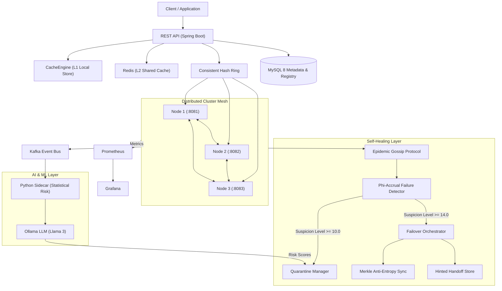

## Resilient Distributed Cache (DC)

[](https://openjdk.org/)
[](https://spring.io/projects/spring-boot)
[](https://www.docker.com/)
[](https://kafka.apache.org/)
[](https://prometheus.io/)
[](https://ollama.ai/)
[](LICENSE)

An enterprise-grade, partition-tolerant ($AP$), self-healing distributed in-memory cache written in **Java 17** and **Spring Boot 3.2.x**. Built upon consistent hashing with virtual nodes, tunable quorum replication ($R + W > N$), epidemic gossip-based membership, adaptive $\Phi$-Accrual failure detection, and anti-entropy Merkle tree self-healing.

Augmented with a **Python 3.10 FastAPI sidecar** and a local **Ollama LLM** for statistical failure-risk prediction, learned cache eviction, and dynamic capacity planning.

---

## Table of Contents

- [System Architecture](#-system-architecture)
- [Key Features](#-key-features)
- [Technology Stack](#-technology-stack)
- [Project Phased Roadmap](#-project-phased-roadmap)
- [Getting Started](#-getting-started)
  - [Prerequisites](#prerequisites)
  - [Running with Docker Compose](#running-with-docker-compose)
- [API Surface](#-api-surface)
- [Chaos Engineering & Verification](#-chaos-engineering--verification)
- [Observability & Dashboards](#-observability--dashboards)
- [Repository Structure](#-repository-structure)
- [License](#-license)

---

## System Architecture



---

## Key Features

- **Multi-Tiered Caching Hierarchy:** High-speed in-memory L1 cache with lock-safe $O(1)$ LRU eviction and scheduled TTL purge reapers, backed by Redis as a shared L2 store.
- **Consistent Hashing & Dynamic Ring:** Ring topology utilizing 64-bit Murmur/MD5 token partitioning and configurable virtual nodes (default: 50–100 tokens/node) to guarantee balanced load distribution.
- **Quorum Consistency ($R + W > N$):** Configurable $N$-way replication with majority consensus validation ($W \ge 2, R \ge 2$ when $N = 3$), providing tunable consistency across node churn.
- **Adaptive Failure Detection:** Implements the Hayashibara et al. $\Phi$-Accrual algorithm:
  $$\Phi = -\log_{10}(P_{\text{later}}(t - t_{\text{last}}))$$
  Distinguishes temporary network anomalies from permanent node crashes, eliminating arbitrary heartbeat timeouts.
- **Self-Healing & Anti-Entropy:**
  - **Quarantine Isolation:** Suspicious nodes are isolated before full ring eviction.
  - **Merkle Tree Reconciliation:** Synchronizes divergent key ranges in $O(\log N)$ network exchanges.
  - **Asynchronous Read-Repair & Hinted Handoff:** Recovers missing mutations automatically upon node recovery without thundering-herd spikes.
- **AI-Powered Predictive Operations:**
  - **Predictive Failure Detection:** Telemetry is scored via a Python sidecar and Ollama LLM to proactively drain and quarantine degrading nodes.
  - **Intelligent Eviction:** Evaluates access frequencies and key recomputation costs to evict low-value items.
  - **Capacity Planning:** Generates automated scale-out recommendations.
  - **Deterministic Fallback:** Degrades gracefully to statistical baselines if AI components are offline.

---

## Technology Stack

| Layer | Technologies |
|---|---|
| **Core Service** | Java 17, Spring Boot 3.2.x (Web, Data JPA, Security, Actuator, Validation) |
| **Data Persistence** | MySQL 8 (Node Registry, Cache Metadata, Key Statistics, Audit Logs) |
| **L2 Shared Cache** | Redis 7.2 (Lettuce Driver) |
| **Messaging & Events** | Apache Kafka (Telemetry, Membership, Rebalance, Hinted Handoff) |
| **AI / ML Runtime** | Python 3.10 (FastAPI sidecar), Ollama (Local Llama 3) |
| **Observability** | Micrometer, Prometheus, Grafana |
| **Containerization** | Docker, Docker Compose |
| **Testing** | JUnit 5, Mockito, Testcontainers |

---

## Project Phased Roadmap

- **[x] Phase 1 — Foundation & Core Cache Engine:** Single-node L1 cache, LRU eviction, TTL cleanup, Spring Security (BCrypt + API key), MySQL metadata persistence, Actuator metrics, Swagger UI.
- **[x] Phase 2 — Distribution Layer:** Consistent hash ring with virtual nodes, node registration API, inter-node HTTP forwarding, Redis L2 shared layer, Kafka event backbone.
- **[x] Phase 3 — Cluster Membership & Replication:** Gossip protocol, $\Phi$-Accrual failure detector, $N$-way replication, Quorum reads/writes ($R + W > N$), hinted handoff storage.
- **[x] Phase 4 — Self-Healing Engine:** Merkle tree anti-entropy background synchronization, asynchronous read repair, node quarantine, failover orchestrator, chaos test harness.
- **[x] Phase 5 — AI Integration & Enterprise Hardening:** Python FastAPI ML sidecar, Ollama LLM client, predictive failure quarantine, intelligent eviction, CI/CD GitHub Actions, Jira automation hooks.

---

## Getting Started

### Prerequisites

- [Docker](https://docs.docker.com/get-docker/) (v24.x+) and [Docker Compose](https://docs.docker.com/compose/) (v2.x+)
- [Java 17 JDK](https://adoptium.net/) (for local development)
- [Maven 3.9+](https://maven.apache.org/)

### Running with Docker Compose

To boot the entire 3-node cluster along with MySQL, Redis, Kafka, Zookeeper, and Prometheus:

```bash
# 1. Clone the repository
git clone https://github.com/your-org/selfheal-dc.git
cd selfheal-dc

# 2. Build and start all services in detached mode
docker compose up -d --build

# 3. Check container status
docker compose ps
```

The services will be accessible at:
- **Node 1 (Leader/Gateway):** `http://localhost:8081`
- **Node 2:** `http://localhost:8082`
- **Node 3:** `http://localhost:8083`
- **Swagger UI:** `http://localhost:8081/swagger-ui.html`
- **Prometheus Scraper:** `http://localhost:9090`
- **MySQL 8:** `localhost:3306`

---

## API Surface

All requests require the cluster token header: `X-DC-API-KEY: dc-secret-cluster-token-xyz`.

### Cache Operations

| Method | Endpoint | Description |
|---|---|---|
| `POST` | `/api/v1/cache` | Put entry with replication & quorum ($W$) |
| `GET` | `/api/v1/cache/{key}` | Read entry with quorum consensus ($R$) |
| `DELETE`| `/api/v1/cache/{key}` | Delete entry across replicas |
| `GET` | `/api/v1/cache/stats` | Retrieve cache hit/miss/eviction metrics |

### Cluster & Self-Healing

| Method | Endpoint | Description |
|---|---|---|
| `GET` | `/api/v1/cluster/ring` | Current hash ring state and virtual node mapping |
| `GET` | `/api/v1/cluster/health` | Aggregated $\Phi$-accrual suspicion metrics |
| `POST` | `/api/v1/cluster/heal` | Force on-demand Merkle-tree anti-entropy run |
| `GET` | `/api/v1/cluster/quarantine`| List active quarantined nodes |
| `POST` | `/api/v1/cluster/rebalance`| Trigger manual hash ring rebalance |

### AI Operations

| Method | Endpoint | Description |
|---|---|---|
| `GET` | `/api/v1/ai/failure-predictions/{nodeId}` | Statistical risk score + Ollama failure analysis |
| `GET` | `/api/v1/ai/eviction-suggestions` | Rank least valuable cache keys via LLM |
| `GET` | `/api/v1/ai/capacity-plan` | Cluster utilization and scale-out report |

> *A complete Postman collection is included under `postman/Self-Healing-Distributed-Cache-Collection.json` for one-click API testing.*

---

##  Chaos Engineering & Verification

The repository includes automated fault-injection scripts under `chaos/`:

```bash
# Execute the full end-to-end chaos recovery harness
chmod +x chaos/*.sh
./chaos/chaos-runner.sh
```

### Chaos Scenarios Verified:
1. **Mid-Traffic Node Kill:** Kills a random node during active writes; validates zero data loss via quorum consensus ($W=2$) and hinted handoff.
2. **Degraded Network Injection:** Uses Linux `tc netem` to inject 250ms latency; verifies that the adaptive $\Phi$-detector avoids false-positive failovers.
3. **Partition Reconciliation:** Validates that Merkle anti-entropy isolates divergent token ranges and repairs stale replicas on rejoin.

---

##  Observability & Dashboards

Key Prometheus metrics exposed at `/actuator/prometheus`:

| Metric Name | Type | Description |
|---|---|---|
| `dc_cache_hits_total` / `dc_cache_misses_total` | Counter | Cache hit/miss rates |
| `dc_evictions_total{reason="lru|ai"}` | Counter | Eviction attribution breakdown |
| `dc_heartbeat_phi{node="..."}` | Gauge | Live $\Phi$-Accrual suspicion index |
| `dc_failover_duration_seconds` | Timer | Latency to evict and rebalance dead nodes |
| `dc_handoff_pending_total` | Gauge | Count of deferred writes waiting for recovery |
| `dc_ai_failure_risk{node="..."}` | Gauge | Predictive failure probability ($0.0 - 1.0$) |

Import the pre-configured Grafana dashboard template from:
`docker/grafana/dashboards/cluster-health-dashboard.json`

---

## Repository Structure

```text
selfheal-dc/
├── pom.xml                               # Root Maven Project Object Model
├── docker-compose.yml                    # Multi-node cluster orchestration
├── .gitignore                            # Environment, build, and IDE exclusions
├── README.md                             # Project documentation
├── postman/                              # Ready-to-import Postman API collection
├── chaos/                                # Chaos testing scripts (kill, latency, harness)
├── docker/                               # Container configs (MySQL, Prometheus, Grafana)
├── python-sidecar/                       # FastAPI Statistical ML Risk Scoring sidecar
├── .github/workflows/                    # CI/CD pipelines & nightly chaos workflows
└── src/
    ├── main/java/com/yp/selfheal/dc/
    │   ├── ai/                          # Ollama client, sidecar client, AI workflows
    │   ├── cache/                       # L1 local store, LRU eviction, TTL manager
    │   ├── cluster/                     # Gossip protocol, heartbeat, Phi detector
    │   ├── config/                      # Spring, Redis, Kafka, Swagger, Security config
    │   ├── controller/                  # REST API controllers
    │   ├── dto/                         # Data transfer records
    │   ├── healing/                     # Merkle tree, failover, quarantine, read repair
    │   ├── messaging/                   # Kafka event producers & consumers
    │   ├── model/                       # JPA entities (Node, Metadata, KeyStats, Audit)
    │   ├── replication/                 # Quorum coordinator, replica router, handoffs
    │   ├── repository/                  # Spring Data JPA repositories
    │   ├── ring/                        # Consistent hash ring, virtual nodes, partitioner
    │   └── telemetry/                   # Prometheus metrics emitters
    └── test/java/com/yp/selfheal/dc/    # Unit, integration, and Testcontainers suites
```

---

##  License

This project is licensed under the GNU General Public License v3.0. See the [LICENSE](LICENSE) file for details.
